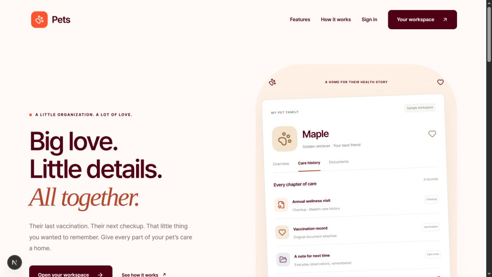
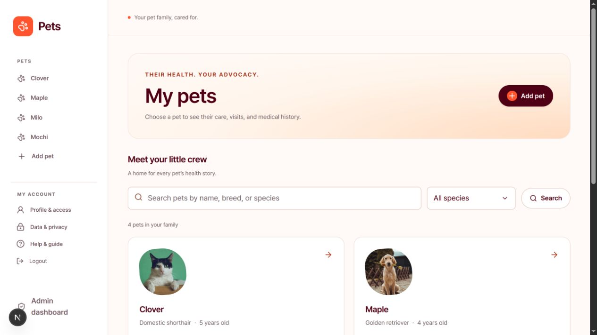
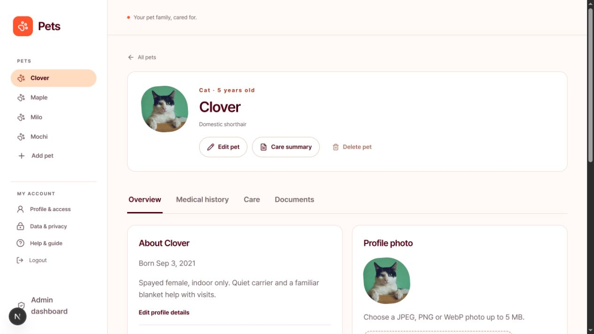
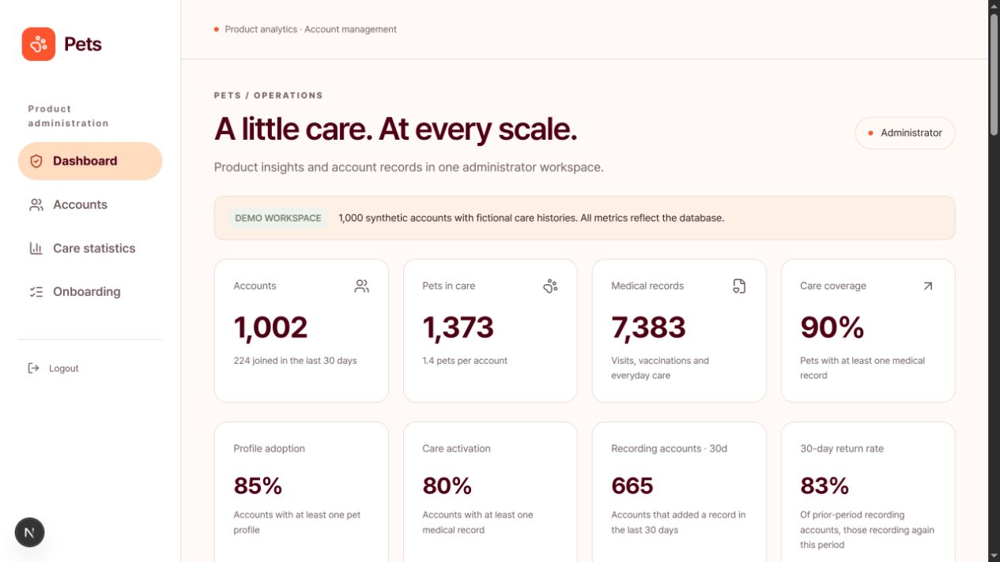
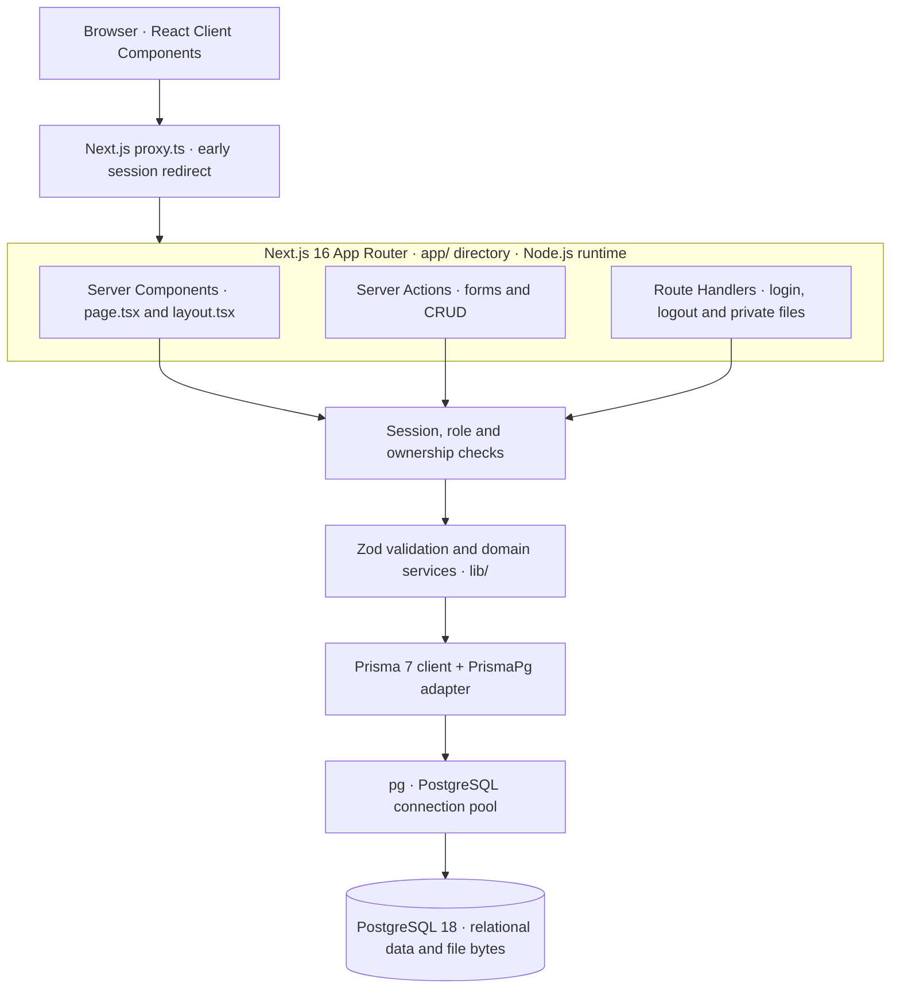
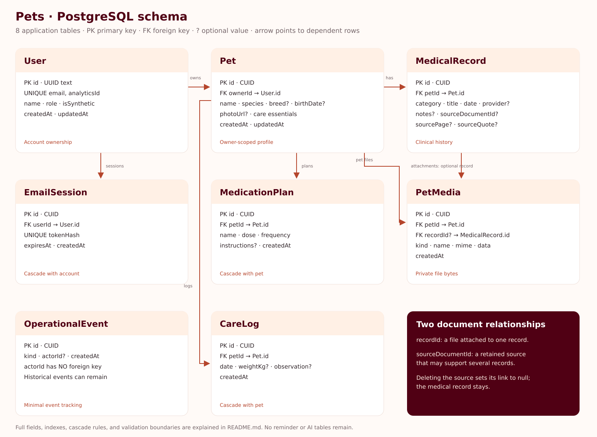

# Pets

**A home for every pet’s care story.**

Pets is a full-stack pet-care organizer built with Next.js, React, TypeScript, Prisma, and PostgreSQL. Owners can keep profiles, medical history, photos, medication plans, and everyday observations together. A separate administrator workspace supports member management and product analytics.

The app runs locally with Docker Compose and includes a substantial fictional dataset for exploring the interface. It has no paid subscription, external AI service, or API-key requirement.

> **Demo access:** sign-in accepts an email without verifying ownership, including administrator emails. Use fictional data and a trusted local environment. This is not production-ready authentication.

[Quick start](#quick-start) · [Screenshots](#screenshots) · [Features](#features) · [Development](#development) · [Data and architecture](#data-and-architecture) · [Verification](#verification)

## Screenshots

Captured from the running app using fictional seed data. Counts and dates change as the workspace is used.

### Public website



### Your pet family



### Pet workspace



### Administration



## Features

| For pet owners                                             | For administrators                                                    |
| ---------------------------------------------------------- | --------------------------------------------------------------------- |
| Create, view, edit, and delete pet profiles                | Create members and edit names and sign-in emails                      |
| Search pets by name, breed, or species                     | Search accounts and inspect their pets and records                    |
| Record checkups, vaccinations, medications, and procedures | Create, edit, and delete pets and medical records for an account      |
| Filter medical history and keep clinic details and notes   | Delete members with explicit confirmation and associated-data cleanup |
| Upload profile photos and image attachments                | Review account growth, species mix, and care coverage                 |
| Store microchip, allergies, and emergency contacts         | Explore care statistics and onboarding stages                         |
| Manage medication plans and care logs                      | View statistical forecasts based on stored activity                   |
| Print or save selected care summaries                      | Access cross-account data through role-checked admin actions          |

Profile photos accept JPEG, PNG, and WebP up to **5 MB**. Record image attachments accept the same formats up to **10 MB**, with at most **20 files per pet**, including its photo. Uploaded profile photos are resized and have metadata stripped; image attachments retain their original bytes.

**PDF uploads and all runtime AI features have been removed.** Existing PDFs, if retained from an older database, can still be downloaded. Printing or saving a care summary as a PDF remains available. Clinical records are entered by the user; the app does not infer treatment schedules or provide medical advice.

## Quick start

### Requirements

- Docker with Docker Compose and a running Docker daemon.
- Available ports **3017** for the website and **55437** for local PostgreSQL access.
- Git to clone the repository.

No host Node.js installation is needed for the Docker workflow.

### 1. Clone and configure

```sh
git clone https://github.com/elliotshohet/pets-saas.git
cd pets-saas
cp .env.example .env
chmod 600 .env
```

Configure these values in the ignored `.env` file:

| Variable       | Purpose                                                                                                          |
| -------------- | ---------------------------------------------------------------------------------------------------------------- |
| `DATABASE_URL` | Host database connection. The example uses `127.0.0.1:55437`; Compose overrides the app connection to `db:5432`. |
| `APP_URL`      | Exact browser origin, such as `http://127.0.0.1:3017`. Login and logout validate this origin.                    |
| `ADMIN_EMAIL`  | Email granted administrator access at sign-in. The example uses `admin@pets.example`.                            |

Keep `.env` private. No authentication secret, password, or AI key is required. Changing `ADMIN_EMAIL` does not automatically revoke roles already granted to other accounts.

### 2. Start the website

```sh
docker compose up -d --build --wait
```

Open [http://127.0.0.1:3017](http://127.0.0.1:3017), or the origin you configured in `APP_URL`.

Startup generates the Prisma client, applies migrations, provisions the demo owner, and seeds an empty workspace. The app runs `next dev` with mounted source and Fast Refresh. PostgreSQL data persists in the named `pets_data` volume.

### 3. Sign in and explore

Enter an email at `/sign-in`. An existing email opens that account; a new email creates an empty member workspace. `/sign-up` redirects to the same email-only form. All accounts land on `/dashboard`.

Use the configured administrator email to explore the seeded pets. Its user sidebar includes **Admin dashboard**, which opens `/admin`. The admin sidebar contains **Dashboard, Accounts, Care statistics, Onboarding**, and **Logout**.

A useful first walkthrough:

1. Open a pet and inspect its Overview and Medical history.
2. Add or edit a medical record, then refresh to confirm persistence.
3. Add care essentials, a medication plan or a weight observation.
4. Attach an image to a medical record or replace the profile photo.
5. Open Care summary, choose records, and print or save a PDF.
6. In Admin → Accounts, open a member to manage their profile, pets, and care records.

### Access from your phone

Set `APP_URL` to `http://<computer-LAN-IP>:3017`, then recreate the app to reload configuration:

```sh
docker compose up -d --force-recreate --wait app
```

Open that exact address on a device connected to the same network. The app listens on all interfaces; PostgreSQL is bound to localhost. The computer’s LAN address can change with DHCP.

## Development

### Run Node.js directly

Requires Node.js **22.12+** (24 recommended), npm, and PostgreSQL. Configure `.env` first.

```sh
npm ci
docker compose stop app
docker compose up -d --wait db
npm run db:setup
npm run dev
```

For an external PostgreSQL instance, set `DATABASE_URL` and skip the database container command. The native and Docker app servers cannot occupy port 3017 simultaneously.

For a production build check:

```sh
npm run build
# Stop the development server before starting the production server.
npm start
```

The normal Compose image runs the development server; it does not build or deploy a production release.

### Common commands

| Task                                            | Command                                                        |
| ----------------------------------------------- | -------------------------------------------------------------- |
| Service status                                  | `docker compose ps`                                            |
| App logs                                        | `docker compose logs -f app`                                   |
| Stop and preserve data                          | `docker compose stop`                                          |
| Start again                                     | `docker compose up -d --wait`                                  |
| Rebuild dependencies and app cache              | `docker compose up -d --build --renew-anon-volumes --wait app` |
| Apply migrations, generate the client, and seed | `docker compose exec -T app npm run db:setup`                  |
| Format source                                   | `npm run format`                                               |
| Check formatting                                | `npm run format:check`                                         |

Do not edit previously applied migrations. Add a new migration for schema changes, review its SQL, then run `db:setup`. The single baseline migration creates the complete current schema, including required ownership and the role constraint.

### Troubleshooting

| Symptom                                          | Check                                                                                      |
| ------------------------------------------------ | ------------------------------------------------------------------------------------------ |
| Login rejected because of origin                 | Browser hostname and port must match `APP_URL`; recreate the app after changing `.env`.    |
| Admin page returns not found                     | Sign in with the configured admin account; authorization checks the current database role. |
| Docker cannot start                              | Confirm `docker info` works and ports 3017/55437 are available.                            |
| Dependencies appear stale                        | Rebuild with `--renew-anon-volumes`; preserve the PostgreSQL volume.                       |
| Generated files cannot be written                | The container runs as UID 1000; the checkout must be writable by that user.                |
| Database connection fails                        | Confirm `db` is healthy and the host connection uses port 55437. Containers use `db:5432`. |
| Old bookmarked pet page is missing after a reset | Reseeding generates new pet IDs. Open the dashboard to find the new profiles.              |

## Technology and project structure

| Layer                | Technology                                                  |
| -------------------- | ----------------------------------------------------------- |
| Application          | Next.js 16.4 App Router, React 19.3, TypeScript 6           |
| Database             | PostgreSQL 18, Prisma 7.10, Prisma PostgreSQL adapter       |
| Validation and media | Zod, Sharp                                                  |
| Interface            | CSS, Lucide icons, locally served Pretendard font           |
| Development          | Node.js 24 Docker image, ESLint, Prettier, Node test runner |

Exact dependency versions are pinned in `package.json` and `package-lock.json`.

`app/` contains pages, route handlers, and Server Actions; `components/` holds the shared interface; `lib/` holds session, validation, CRUD, care, and analytics logic; `prisma/` holds the schema, migrations, and seeds; `tests/` holds unit and database integration checks. Screenshot assets live in `docs/screenshots/`; this README is the single project guide. `AGENTS.md` and `CLAUDE.md` are coding-agent instructions.

### How the technology fits together

**Next.js App Router.** This application uses the `app/` directory. A `page.tsx` defines a route and a `layout.tsx` supplies its shared shell. The `(workspace)` and `(admin)` route groups organize layouts without adding those names to URLs. Pages render as Server Components by default, keeping database access on the server. Client Components are used for form state, validation feedback, dialogs, photo previews, and hash-based care tabs. There is no Pages Router or separate Express backend.

**React and TypeScript.** React builds the reusable interface. `useActionState` connects forms to Server Actions and exposes pending/error state. TypeScript checks component props and service boundaries before a build. Prisma generates types from the schema, while Zod checks untrusted input at runtime; compile-time types alone cannot validate browser submissions.

**Server Actions and Route Handlers.** Server Actions perform pet, record, member, and care mutations. They read the current session, validate input, enforce ownership or administrator access, and write to the database. Successful writes revalidate the relevant layout/pages and redirect or return feedback. Route Handlers in `app/api/` handle email login/logout and authenticated file/photo downloads. Next.js config limits Server Action request bodies to 12 MB, and media validation applies smaller per-file limits.

**PostgreSQL and Prisma.** PostgreSQL provides durable relational storage, foreign keys, unique constraints, and transactions. Prisma maps the eight models to tables and generates the typed client. `@prisma/adapter-pg` connects that client to the `pg` driver. `lib/db.ts` reuses the client during development to avoid opening a new client for each hot reload. SQL migrations preserve the schema’s history; `db:setup` applies migrations before seeding. The database connection is server-only.

**Validation and media.** Zod trims and validates names, categories, lengths, and calendar dates. Sharp decodes uploaded image contents, rejects unsupported formats, and normalizes profile photos. File bytes are stored in PostgreSQL, simplifying local persistence and backups at the cost of larger databases. The CSS, Lucide icons, and locally served Pretendard font need no external asset service at runtime.

**Sessions.** Email-only login creates a cryptographically random session token, sends it in an HttpOnly cookie, and stores only its SHA-256 hash. Protected pages validate its expiry against PostgreSQL. `proxy.ts` handles early redirects, while database session, role, and ownership checks are the authorization boundary. This is deliberately unverified demo login, not proof that a person owns an email.

**Docker and checks.** Compose runs the Next.js Node.js application and PostgreSQL, with optional Prisma Studio. Source is bind-mounted for Fast Refresh; anonymous volumes isolate container dependencies/cache, and a named volume persists PostgreSQL. ESLint checks code patterns, TypeScript checks types, Prettier formats source, and the Node test runner executes TypeScript tests through `tsx`. A production build verifies compilation; it does not deploy the app.

### Design choices for the take-home

The printable care summary is the chosen extra feature: an owner can bring a concise, selected medical history to a vet without giving someone access to the whole account. The core is pet/record CRUD, an overview, filtering, and durable persistence. Administration and care logs build on the same relationships.

One tradeoff to improve is email-only login: it makes the local demo easy to explore, but real users need verified identity and account recovery. Another is storing files in PostgreSQL: useful for one-command local setup, but object storage would be a better fit for larger deployments. The required under-ten-minute Loom should demonstrate the workflow, explain these choices, and discuss one of these tradeoffs. No recording or submission is claimed here.

## Data and architecture



Server Components load page data. Server Actions validate submitted fields, derive identity from the session, persist changes, and revalidate affected pages. `proxy.ts` performs an early cookie check; server-side session and ownership checks enforce access.

| Model              | Stores                                                                                 |
| ------------------ | -------------------------------------------------------------------------------------- |
| `User`             | Name, email, USER/ADMIN role, synthetic flag, and stable account-directory identifier  |
| `EmailSession`     | Hashed session token, user relation, and expiry                                        |
| `Pet`              | Owner, profile, photo reference, and care essentials                                   |
| `MedicalRecord`    | Category, title, clinical date, provider, notes, and optional retained source evidence |
| `PetMedia`         | Private image/document bytes and pet or record links                                   |
| `MedicationPlan`   | Prescribed medication, dose, frequency, and instructions                               |
| `CareLog`          | Dated weight measurements and observations                                             |
| `OperationalEvent` | Event kind, actor identifier, and timestamp                                            |

### Schema diagram



The canonical definition is [prisma/schema.prisma](prisma/schema.prisma). Relation arrays such as `User.pets` and `Pet.records` are Prisma navigation properties, not separate database columns. `?` denotes a nullable scalar field. PostgreSQL also stores `_prisma_migrations` for migration history; it is not application data.

### Table-by-table schema

#### User — an account and its ownership boundary

- `id`: text primary key generated as a UUID by the application. `name` and unique `email` identify the account; email input is trimmed and lowercased before persistence.
- `analyticsId`: a unique, database-generated UUID stored as text. Admin account links use this stable identifier; it does not anonymize the displayed name or email.
- `role`: text with default `USER`; a SQL check allows only `USER` or `ADMIN`. `isSynthetic` defaults to false and distinguishes fictional seed accounts.
- `createdAt` defaults to the insertion time; `updatedAt` is maintained by Prisma on updates. Indexes on creation time and role support administrative counts and role-based queries.
- One account can own many pets and sessions. The pet foreign key restricts direct account deletion while pets remain; the member deletion service removes those pets inside the same transaction.

#### EmailSession — revocable access

- `id` is a generated CUID primary key. Unique `tokenHash` stores the SHA-256 hash, never the raw cookie token.
- Required `userId` references `User.id`. `expiresAt` determines whether the session remains valid; `createdAt` records when it began.
- Separate indexes on `userId` and `expiresAt` support account-wide revocation and expired-session cleanup. Deleting an account cascades to its sessions.

#### Pet — profile and care essentials

- Generated CUID `id` and indexed, required `ownerId` link the profile to a user. Required `name` and `species` support the directory; species values are checked in application validation.
- Optional `breed`, `birthDate` (PostgreSQL DATE), and `notes` describe the animal. `photoUrl` points to a bundled illustration or a private photo route, rather than holding image bytes.
- Optional `microchip`, `allergies`, `emergencyContact`, and `medications` store care essentials and free-text medication notes. Structured prescriptions live in `MedicationPlan`.
- `createdAt` and `updatedAt` track profile changes. A pet owns records, files, medication plans, and logs; deleting it cascades to these child rows.

#### MedicalRecord — a dated clinical event

- Generated CUID `id`; required `petId` references the parent pet. The record inherits account ownership through that relationship.
- Required `category` is the PostgreSQL `Category` enum; required `title` and clinical `date` describe the event. Optional `provider` and `notes` preserve clinic details and observations. Clinical date is distinct from `createdAt`, which measures when the app recorded it; `updatedAt` tracks edits.
- A composite index on `(petId, date)` supports history reads. Records are not globally unique by title/date because separate legitimate events can share these values.
- Optional, indexed `sourceDocumentId` references `PetMedia`; optional `sourcePage` and `sourceQuote` preserve evidence from documents retained after the former import feature was removed. Deleting the source file sets the reference to null while leaving the record and excerpt intact.
- A record can have multiple attached images. Deleting the record cascades to files attached through `PetMedia.recordId`.

#### PetMedia — stored file contents

- Generated CUID `id`; required, indexed `petId` references the owning pet. Optional, indexed `recordId` associates an attachment with a medical record; the upload service verifies both belong to the same pet.
- `kind` distinguishes photos from documents; `name` is the display title, `mime` the content type, `data` PostgreSQL BYTEA file contents, and `createdAt` the upload time.
- A file may be the retained source for several records through the separate `RecordSource` relation. This is different from being attached to one record. Pet deletion removes all its files; record deletion removes its record-bound attachments. Downloads always verify owner/admin access.

#### MedicationPlan — a structured prescription

- Generated CUID `id`; required, indexed `petId` references a pet and cascades on its deletion.
- Required `name`, `dose`, and `frequency` hold user-entered prescription details; `instructions` is optional and `createdAt` records entry time.
- These are descriptive fields, not automated schedules. No treatment dates, reminders, or dosing recommendations are generated.

#### CareLog — observations over time

- Generated CUID `id`; required `petId` and calendar `date` identify an entry. Optional `weightKg` is a floating-point measurement and `observation` is text; validation requires at least one of them.
- `createdAt` records insertion time. A composite index on `(petId, date)` supports chronological charts and history. Entries cascade when their pet is deleted; multiple observations on one day are allowed.

#### OperationalEvent — minimal write tracking

- Generated CUID `id`, required `kind`, optional `actorId`, and `createdAt` record an application event. Indexes on creation time and `(kind, createdAt)` support activity queries.
- `actorId` deliberately has no foreign key, so historical actor identifiers survive account removal. It is a correlation value, not proof of identity or authorization.
- Events do not store medical text, file bytes, or session tokens. This is best-effort tracking with no automatic retention policy, not a security audit log.

### Integrity and deletion rules

Foreign keys enforce valid parent links, but owner and role restrictions are checked in server code rather than PostgreSQL row-level security. A transaction keeps administrator member deletion and its event together; deleting a member removes pets, records, files, medication plans, logs, and sessions. A standalone operational event may remain. Removing a source document preserves linked medical records through `ON DELETE SET NULL`.

Unique constraints protect account emails, admin-directory identifiers, and session hashes. Zod additionally validates supported species, input lengths, past clinical dates, and meaningful log values; these application checks complement the database constraints. There are no auth-provider, password, AI-job, chat, or reminder tables in the current schema. A single baseline migration creates the current schema; retired tables are not created.

Pet and record IDs are generated CUIDs. Calendar dates use PostgreSQL `DATE`; validation uses America/Los_Angeles for today. Record categories are `CHECKUP`, `VACCINATION`, `MEDICATION`, `PROCEDURE`, and `OTHER`.

Pet deletion cascades through its records and care data. Member deletion removes associated pets before deleting the account. Changing a member email revokes their active sessions. Member-management actions cannot edit or delete administrator accounts or assign administrator roles.

### Access and privacy

Sessions last eight hours. Cookies are HttpOnly and SameSite, and Secure under HTTPS; token hashes are stored in PostgreSQL. Login/logout validate the configured origin. Member reads and writes are scoped to their account, while authorized admins can see identified accounts and their care records. Files use private, non-cacheable responses.

**Email-only access is an account selector, not verified identity.** Anyone who can reach the site can enter another account’s email. Database tools also bypass application ownership checks. A public deployment needs verified authentication, stronger operational controls, and an explicit data policy.

### Seed dataset

A fresh seed contains **1,001 accounts, 1,373 pets, and 7,383 medical records**:

- One demo administrator with Maple, Milo, Clover, and Mochi: four pets and sixteen records.
- 1,000 synthetic members with 1,369 pets and 7,367 records.

Synthetic emails use `example.test`. Repeated setup preserves populated workspaces and existing synthetic accounts. Counts change with normal use. Synthetic analytics demonstrate the interface; they do not represent customer adoption.

### Analytics and forecasts

Admin metrics are computed from stored rows: account growth, species/category distributions, profile adoption, care activation, and care coverage. Onboarding is a current-state snapshot, not a measured conversion funnel. Recording activity uses record creation dates, not clinical visit dates or login activity.

The 30-day forecast uses eight complete trailing UTC weeks. A weighted average of the latest four weeks estimates the next month; low/high weekly pace provides scenarios, not confidence intervals. It requires sufficient history and does not provide clinical predictions. Operational events are best-effort tracking, not a comprehensive or tamper-proof audit trail.

### Inspect the database

For Prisma Studio on Linux:

```sh
docker compose --profile tools up -d --build --wait studio
```

Open [http://127.0.0.1:5555](http://127.0.0.1:5555). This optional service uses host networking and requires the host `DATABASE_URL` from `.env`. On macOS/Windows, or with native dependencies installed, use:

```sh
npm exec prisma -- studio --browser none --port 5555
```

For SQL inspection:

```sh
docker compose exec db psql -U novellia -d novellia_pets
```

Use `\dt` to list tables, `\d "Pet"` to inspect a table, and `\q` to exit. Quote mixed-case identifiers in SQL. For desktop clients, use the host, port, username, database, and password in `.env.example` and `compose.yaml`.

### Backup and reset

Back up the database before destructive changes:

```sh
docker compose exec -T db pg_dump -U novellia -d novellia_pets > pets-backup.sql
```

To replace only the demo workspace’s pets and records:

```sh
docker compose exec -T app npm run db:seed -- --reset
```

**To delete the entire database and reseed everything**, including members, sessions, uploaded files, and records:

```sh
docker compose down -v
docker compose up -d --build --wait
```

The reset is irreversible without a backup and generates new profile IDs. Ordinary `docker compose down` preserves the database volume. Keep backups private; they include account and document data. Backup/restore disaster recovery has not been independently audited.

## Verification

Run checks with native dependencies installed, or prefix each npm command with `docker compose exec -T app`:

```sh
npm run lint
npm run typecheck
npm run format:check
npm test
npm run test:integration
npm run build
```

The latest code checks passed **13 unit tests and 10 PostgreSQL integration tests**, plus lint, typecheck, and production compilation. Tests cover input/date validation, birthdays, database persistence, member isolation, administrator access, member CRUD, session revocation, cascading deletes, and rejection of PDFs disguised as images. Integration tests create temporary fixtures in the configured database and clean them up; run them against a development database.

Manual browser checks have exercised pet/record CRUD, persistence, admin management, private file access, summary selection, and responsive layouts. Screenshots above are fresh captures of the current site. These checks do not replace a full accessibility, physical-device, load, security, or production-readiness audit. OS printing/PDF pagination are not exhaustively tested.

Use `npm audit --omit=dev` and `npm audit` to review dependency advisories. An earlier audit reported no production advisories and five high-severity lint-tooling entries; audit results are time-dependent. Do not apply forced major-version changes without checking compatibility.

## Scope and next steps

The current app focuses on owner-managed care and administrator CRUD. It does not include verified email login, account recovery, MFA, household sharing, clinic integrations, bookings, payments, automated diagnosis, email/push reminders, or runtime AI. Concurrent edits are last-write-wins; very large individual histories would need pagination.

Useful future work includes verified authentication, controlled sharing of selected summaries, account export, backup/restore testing, bounded event retention, and evaluation with real pet owners once access and data handling are ready.

### Development assistance and image credits

OpenAI Codex assisted with implementation, troubleshooting, design, tests, and documentation. It is a development tool; the application has no runtime AI dependency.

Bundled seed photographs illustrate fictional animals and are reused by species. They are served locally, and uploaded photos replace them. Sources are Unsplash under the [Unsplash license](https://unsplash.com/license): [dog](https://images.unsplash.com/photo-1552053831-71594a27632d), [cat](https://images.unsplash.com/photo-1514888286974-6c03e2ca1dba), [rabbit](https://images.unsplash.com/photo-1585110396000-c9ffd4e4b308), [bird](https://images.unsplash.com/photo-1444464666168-49d633b86797), and [guinea pigs](https://images.unsplash.com/photo-1548767797-d8c844163c4c). Downloaded October 13, 2026. Screenshots use fictional data.
