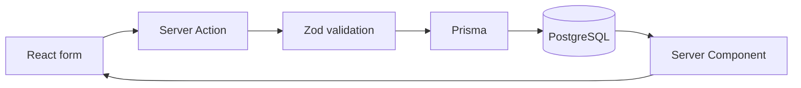

<div align="center">

# Pets Dashboard

### A home for every pet’s health story.

Pet profiles · Medical history · One workspace

**Next.js 16** &nbsp; / &nbsp; **React 19** &nbsp; / &nbsp; **TypeScript** &nbsp; / &nbsp; **PostgreSQL 18**

[Quick start](#quick-start) · [Development](#development) · [Data](#data) · [Architecture](#architecture) · [Verification](docs/verification.md)

</div>

---

## The essentials

| Your pet family                           | Their care history                                               | The whole picture                                 |
| ----------------------------------------- | ---------------------------------------------------------------- | ------------------------------------------------- |
| Add, view, edit, and delete pet profiles. | Manage dated records with categories, clinic details, and notes. | See every pet, record totals, and recent updates. |

Search pets by name, breed, or species. Filter medical history by pet, category, clinic, and date range. Changes persist in PostgreSQL.

> **Scope:** The committed app implements pet and medical-record CRUD, overview, search/filtering, and persistence. A portable medical-history summary is present in the local working tree but is not part of the committed release yet.

## Quick start

Requires Docker with Compose and access to the Docker daemon.

```sh
git clone https://github.com/elliotshohet/pets-dashboard.git
cd pets-dashboard
docker compose up -d --build --wait
```

**Open [localhost:3017](http://127.0.0.1:3017).** Compose runs the Next.js development server with the project folder mounted into the container. Saving code triggers Fast Refresh without rebuilding. Startup generates Prisma, applies migrations and seeds an empty database. No API keys or external accounts are needed; fonts are served locally.

The app and database bind to localhost on ports **3017** and **55437**. Data persists in the `pets_data` volume. `docker-compose` can be used in place of `docker compose`.

<details>
<summary><strong>Stop, restart, or inspect logs</strong></summary>

```sh
docker compose stop
docker compose up -d --wait
docker compose logs -f app
```

`stop` preserves data. `down -v` deletes the database volume.

</details>

## Review the app

1. Open the overview to see your pets, record totals, and recent updates. A freshly seeded workspace contains four fictional pets and sixteen records; an existing workspace may differ.
2. Open **My pets**, search or filter the list, and view a pet’s medical history.
3. Add or edit a pet and a record, then refresh to verify persistence.
4. Open **Medical history** to combine pet, category, clinic, and date filters.
5. Use a temporary record to inspect validation and the delete confirmation.

## Development

The Compose app runs as the unprivileged `node` user. Source is bind-mounted at `/app`; separate container volumes keep `node_modules` and `.next` apart from host files. The PostgreSQL volume is unchanged. No production build runs during image creation or startup.

For ordinary code edits, just save the file. After changing dependencies or the Dockerfile, rebuild and replace dependency/cache volumes:

```sh
docker compose up -d --build --renew-anon-volumes --wait app
```

On this host, use `sg docker -c 'docker-compose up -d --build --renew-anon-volumes --wait app'` if the current session has not picked up Docker group membership. No sudo is needed. For schema edits, add a migration and restart the app, or run `docker compose exec app npm run db:setup`.

### Run Node.js directly

Requires Node.js **22.12+** (24 recommended) and PostgreSQL.

```sh
cp .env.example .env
npm ci
docker compose stop app
docker compose up -d --wait db
npm run db:setup
npm run dev
```

Using an existing PostgreSQL instance? Set `DATABASE_URL` in `.env` and skip the Compose commands. Keep `.env` private. Run the app as your regular user.

| Task                    | Command                                        |
| ----------------------- | ---------------------------------------------- |
| Production build        | `npm run build`                                |
| Start production server | `npm start`                                    |
| Browse the database     | `npx prisma studio --browser none --port 5555` |
| Apply schema updates    | `npm run db:generate && npm run db:migrate`    |

These commands run on the host with local dependencies and a configured database. Production commands remain optional checks; Compose does not use them. Studio opens at [localhost:5555](http://localhost:5555).

## Data

**4 pets · 16 records · Generated CUIDs**

| Maple            | Milo                | Clover             | Mochi       |
| ---------------- | ------------------- | ------------------ | ----------- |
| Golden retriever | Australian shepherd | Domestic shorthair | Holland lop |
| 6 records        | 5 records           | 3 records          | 2 records   |

The seed covers checkups, vaccinations, medication, procedures, and lab results. Visit dates are relative to the seed day. Normal seeding skips a populated workspace.

<details>
<summary><strong>Reset to the seed dataset</strong></summary>

With local dependencies and `.env` configured:

```sh
npm run db:seed -- --reset
```

Or inside the running Compose app:

```sh
docker compose exec app npm run db:seed -- --reset
```

**Replaces all pets and records.** The reset is transactional: failure rolls back the changes. New IDs invalidate old record links. Refresh Prisma Studio afterward.

</details>

> **Upgrading an older checkout?** The removal migrations delete retired feature fields and attachments. Back up that data before applying them if it is needed. Core pet profiles and medical records remain.

## Architecture



| Model           | Contents                                                    |
| --------------- | ----------------------------------------------------------- |
| `Pet`           | Name, species, optional breed, birth date, and notes        |
| `MedicalRecord` | Pet ID, title, category, date, optional provider, and notes |

Both models have generated IDs and timestamps. Record mutations are scoped to the pet. Deleting a pet cascades to its records after confirmation. Server Actions revalidate pages after changes and preserve submitted values on validation errors.

**Deliberate tradeoffs**

- **Local, single-user scope.** No authentication. A multi-user version needs ownership checks on every read and write.
- **Calendar dates.** PostgreSQL `DATE`, with `America/Los_Angeles` used for today. Future birthdays and record dates are rejected.
- **Small histories.** Pet-directory and cross-pet history filters run in PostgreSQL; individual pet histories are loaded and filtered in memory. Larger datasets would need database filtering and pagination.

## Quality checks

```sh
npm test
npm run test:integration
npm run lint
npm run typecheck
npm run format:check
npm run build
```

Integration tests use the configured database and clean up their temporary rows. See [verification notes](docs/verification.md) for results and testing limits.

---

**Built with AI assistance.** OpenAI Codex assisted with planning, implementation, styling, documentation, and verification. No AI service runs inside the app. Supporting tools include Prisma, Zod, Lucide, Pretendard, ESLint, Prettier, and the Node test runner.

[Architecture notes](docs/architecture.md) · [Verification notes](docs/verification.md)

## Submission status

The repository includes setup instructions, seed data, tests, and architecture notes. The committed release does not yet include the required candidate-selected extra feature. A portable medical-history summary is being developed locally and has not been committed or fully verified. No Loom link is stored in this repository; whether a recording or recruiter submission exists externally has not been checked.
