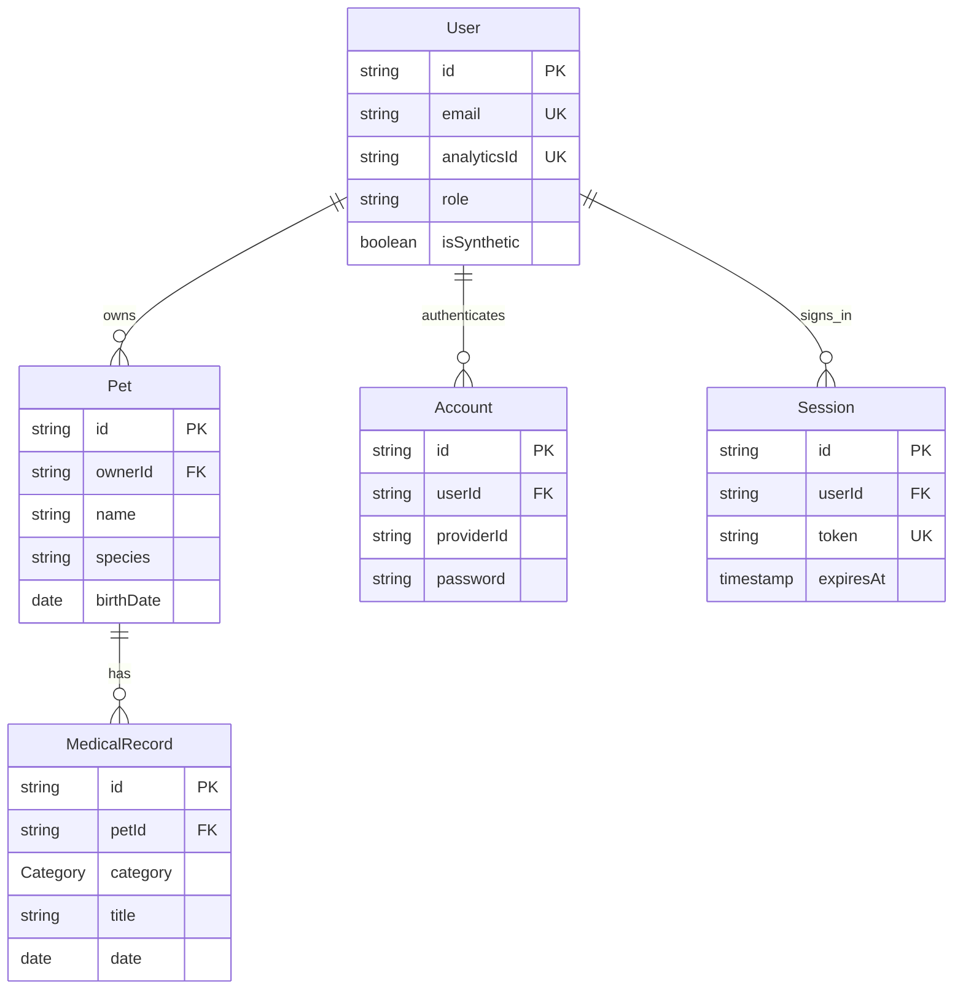

# View the database and understand its schema

[README](../README.md) · [Development](development.md) · [Architecture](architecture.md)

PostgreSQL stores the app's accounts, pets and medical records. Database tools access all accounts directly; the application's owner restrictions do not apply to them. Use them for local inspection. Avoid editing authentication rows or copying password hashes/session tokens into screenshots or logs.

## Option 1: Prisma Studio (visual browser)

Start the database and app with the [README setup](../README.md#start-with-docker). On Linux, run this from the repository folder in a second terminal:

```sh
docker compose --profile tools up -d --build --wait studio
```

Open [Prisma Studio](http://127.0.0.1:5555). Select a table to browse rows and use its filters to find records. Start with `User`, then use a user's `id` to filter `Pet.ownerId`; use a pet's `id` to filter `MedicalRecord.petId`.

This optional Compose service uses Linux host networking so Studio's localhost listener is reachable, and mounts configuration read-only. The host `.env` connection must point to `127.0.0.1:55437`, as in `.env.example`. Studio runs in the background; stop it with `docker compose --profile tools stop studio`. The database and app remain running. Studio can modify rows, so leave them unchanged when inspecting. Port 5555 must be available. The `tools` profile keeps Studio out of normal app startup.

On macOS/Windows, or if you prefer host Node.js, install the repository dependencies with `npm ci` and run:

```sh
npm exec prisma -- studio --browser none --port 5555
```

This uses `DATABASE_URL` from `.env` through `prisma.config.ts`.

## Option 2: PostgreSQL terminal (no host tools needed)

```sh
docker compose exec db psql -U novellia -d novellia_pets
```

At the `psql` prompt:

```sql
\dt
\d "User"
\d "Pet"
\d "MedicalRecord"
```

`\dt` lists tables. `\d` shows columns, types, indexes and foreign keys. Table and camelCase column names must be double-quoted in SQL. Exit with `\q`.

For read-only exploration, start a transaction before your queries:

```sql
BEGIN READ ONLY;
SELECT 'accounts' AS entity, count(*) FROM "User"
UNION ALL SELECT 'pets', count(*) FROM "Pet"
UNION ALL SELECT 'records', count(*) FROM "MedicalRecord";

SELECT u.name, u.email, p.name AS pet, p.species
FROM "User" u JOIN "Pet" p ON p."ownerId" = u.id
ORDER BY u.email, p.name
LIMIT 20;

SELECT p.name AS pet, r.title, r.category, r.date, r.provider
FROM "Pet" p JOIN "MedicalRecord" r ON r."petId" = p.id
ORDER BY r.date DESC
LIMIT 20;
ROLLBACK;
```

## Option 3: Desktop database client

Connect using these local Compose values (for example, in DBeaver, TablePlus or pgAdmin):

| Setting  | Value                 |
| -------- | --------------------- |
| Host     | `127.0.0.1`           |
| Port     | `55437`               |
| Database | `novellia_pets`       |
| User     | `novellia`            |
| Password | `novellia_local_only` |
| Schema   | `public`              |

These are local development database credentials from `compose.yaml`, not the demo app login. An external PostgreSQL setup uses the values in your own `DATABASE_URL`. Containers connect to `db:5432`; host clients use `127.0.0.1:55437`.

## Schema overview

The source of truth is [prisma/schema.prisma](../prisma/schema.prisma). [Migration SQL](../prisma/migrations/) also defines database constraints, including allowed user roles. Prisma relation fields such as `User.pets` are navigation properties, not extra columns.



`Verification` and `RateLimit` are independent supporting tables. `_prisma_migrations` records Prisma's migration history.

## Table reference

`?` means nullable. Unless noted, IDs are text primary keys. Timestamps use Prisma `DateTime`; calendar dates use PostgreSQL `DATE`.

| Table           | Columns                                                                                                                                                                                           |
| --------------- | ------------------------------------------------------------------------------------------------------------------------------------------------------------------------------------------------- |
| `User`          | `id`, `name`, unique `email`, unique `analyticsId`, `role` (default USER), `isSynthetic` (default false), `emailVerified` (default false), `image?`, `createdAt`, `updatedAt`                     |
| `Pet`           | `id` (generated CUID), required `ownerId`, `name`, `species`, `breed?`, `birthDate?` (DATE), `notes?`, `createdAt`, `updatedAt`                                                                   |
| `MedicalRecord` | `id` (generated CUID), required `petId`, `category`, `title`, `date` (DATE), `provider?` (clinic), `notes?`, `createdAt`, `updatedAt`                                                             |
| `Account`       | `id`, `accountId`, `providerId`, `userId`, `password?` (hash), `accessToken?`, `refreshToken?`, `idToken?`, `accessTokenExpiresAt?`, `refreshTokenExpiresAt?`, `scope?`, `createdAt`, `updatedAt` |
| `Session`       | `id`, `userId`, unique `token`, `expiresAt`, `ipAddress?`, `userAgent?`, `createdAt`, `updatedAt`                                                                                                 |
| `Verification`  | `id`, `identifier`, `value`, `expiresAt`, `createdAt`, `updatedAt`                                                                                                                                |
| `RateLimit`     | `id`, unique `key`, integer `count`, bigint `lastRequest`                                                                                                                                         |

Better Auth supplies auth IDs and manages credential/session fields. `analyticsId` is a database-generated random UUID stored as text; admin detail links use it, while names and emails remain visible. The verification model supports the library even though email verification and recovery flows are not enabled.

## Relationships, constraints and indexes

- `Pet.ownerId → User.id`: required, indexed; deleting a user with pets is restricted.
- `MedicalRecord.petId → Pet.id`: deleting a pet cascades to its medical records. An index on `(petId, date)` supports history queries.
- `Account.userId` and `Session.userId → User.id`: indexed; rows cascade when the user is deleted.
- `User.email`, `User.analyticsId`, `Session.token` and `RateLimit.key` are unique.
- `User.createdAt`, `User.role` and `Verification.identifier` have indexes.
- A SQL CHECK restricts `User.role` to `USER` or `ADMIN`.
- `Category` is a PostgreSQL enum: CHECKUP, VACCINATION, MEDICATION, PROCEDURE, OTHER.

Input lengths, supported species and future-date restrictions are validated by the app's Zod schemas. Database foreign keys enforce relationships, but owner-scoped reads/writes are enforced in server code rather than PostgreSQL row-level security. Direct database clients bypass those application checks.

## Persistence and setup

The named `pets_data` volume persists the database. `docker compose stop` and ordinary rebuilds preserve it; `docker compose down -v` deletes it. Follow [migration and seed instructions](development.md#migrations-and-seeds) to upgrade or reset the demo workspace. Do not edit `_prisma_migrations` manually.

### Operational events

`OperationalEvent` records new application activity: text `id` (generated CUID primary key), required text `kind`, nullable text `actorId`, and `createdAt` timestamp (default now). Indexes cover `createdAt` and `(kind, createdAt)`. Actor IDs have no foreign key so historical events survive account removal; admin views do not display them. Events exclude passwords, session tokens and medical text. This is best-effort operational tracking with no automatic retention cleanup, not a security audit trail.

### Care organizer tables

- `Pet`: optional `photoUrl`, `microchip`, `allergies`, `emergencyContact`, and legacy/free-text `medications` fields. A blank photo URL means intentionally removed; NULL seed photos are populated once.
- `PetMedia`: ID, pet ID, optional medical-record ID, kind (PHOTO/DOCUMENT), name, MIME type, binary data, and creation timestamp. Pet/record foreign keys cascade deletion. Uploaded bytes are stored in PostgreSQL, so the existing persistent database volume and backups include them. Indexes cover pet and record IDs.
- `MedicationPlan`: pet ID, name, prescribed dose, frequency, optional instructions and timestamp. Separate structured entries are included in summaries. No treatment is inferred.
- `CareTask`: pet ID, title, kind, due calendar date, IANA timezone, optional recurrence interval in days/instructions, completion timestamp and creation timestamp. Indexed by pet/date; deleted with the pet.
- `CareLog`: pet ID, calendar date, optional weight in kg and observation, and timestamp. Indexed by pet/date; deleted with the pet.

All care operations check the account session and pet ownership (or the administrator role); ordinary members cannot access another account's files, calendar, summaries or care items. Local email-only demo mode deliberately allows choosing any account's email and is not an identity-security boundary.
